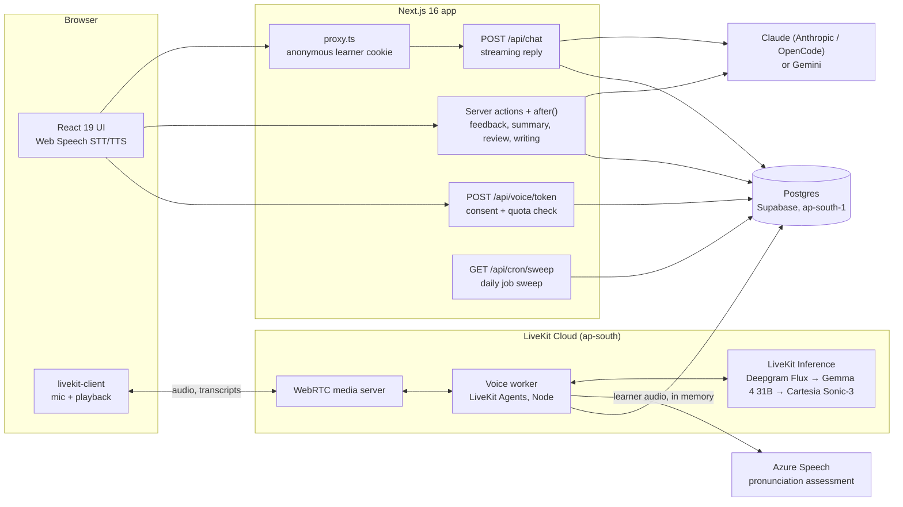
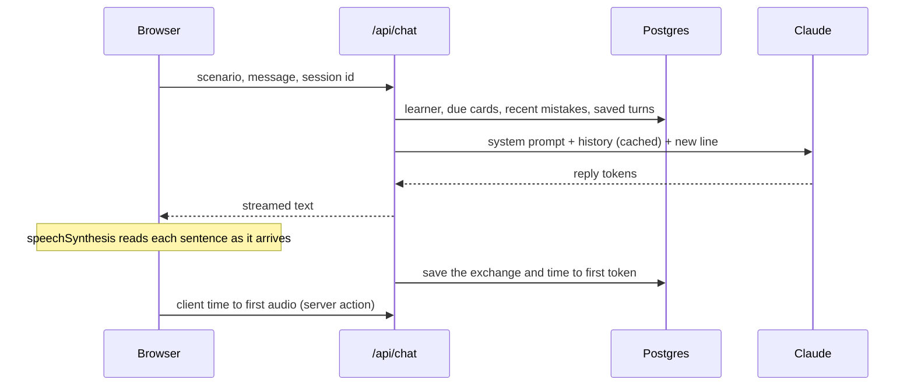
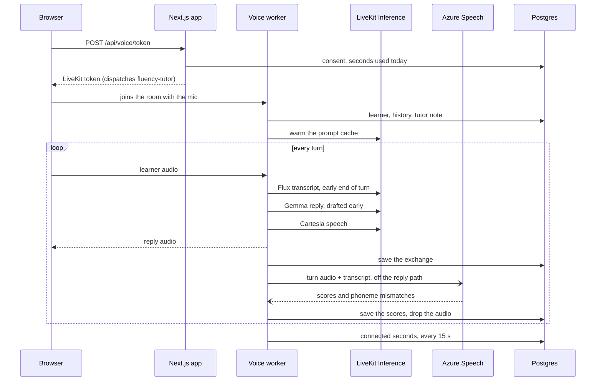
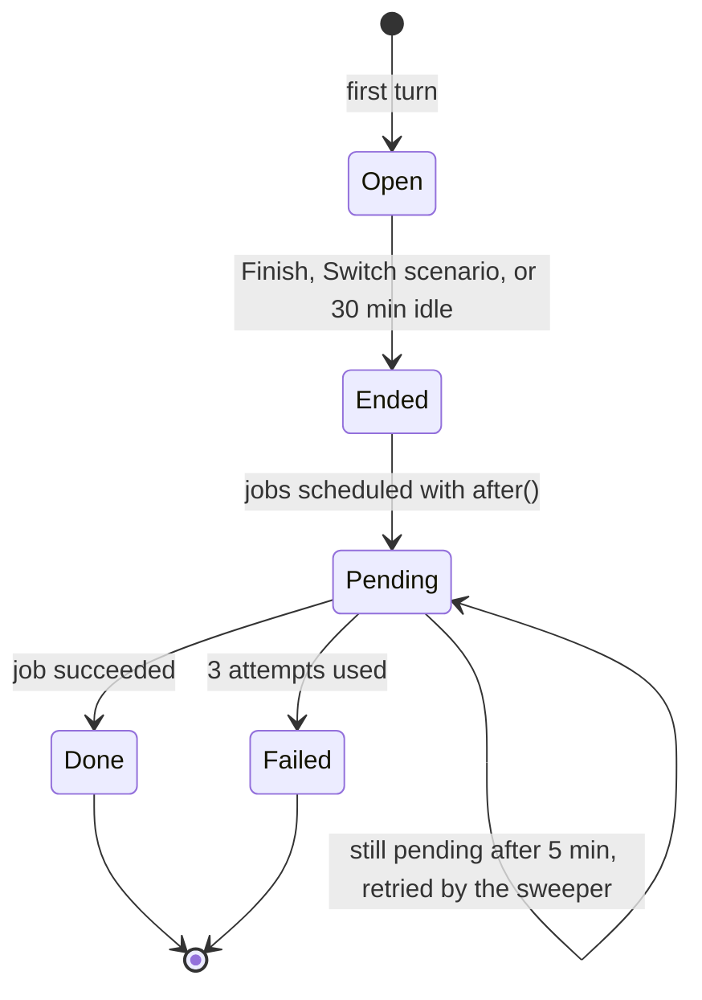
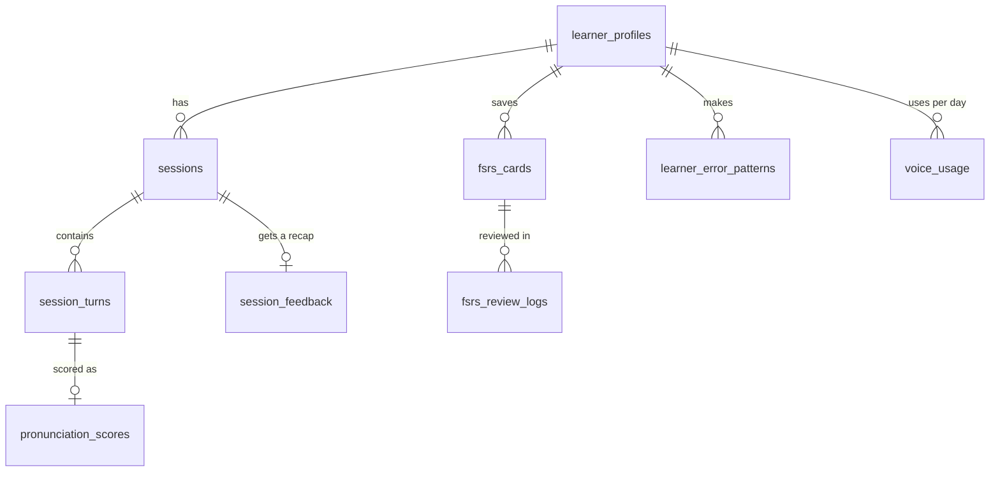
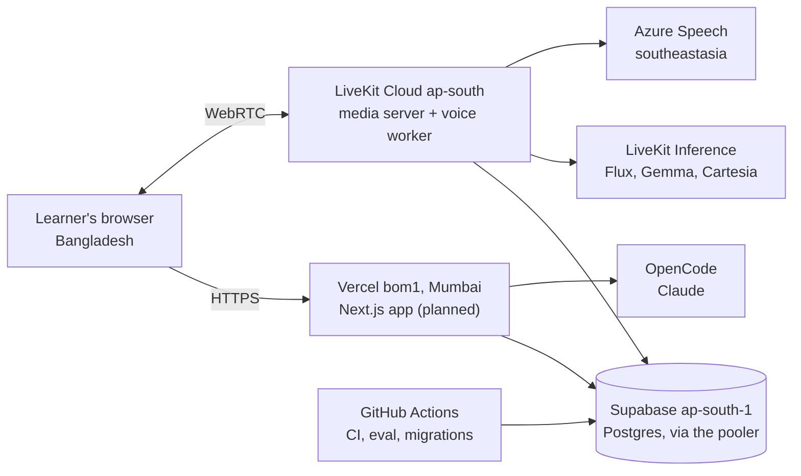

# Fluency

A web app for practicing spoken English, built first for Bangla speakers. You pick a scenario, speak or type, and a conversation partner replies out loud. After each session you get feedback, flashcards for review, and a pronunciation score when you use live voice.

What is built so far and what comes next: [doc/status.md](doc/status.md) and [doc/roadmap.md](doc/roadmap.md).

## Contents

- [User manual](#user-manual): how a learner uses every screen
- [System architecture](#system-architecture): the runtimes, request flows, background jobs, data model, security and deployment
- [Requirements](#requirements), [Setup](#setup), [Run the app](#run-the-app), [Live voice](#live-voice), [Tests and evaluation](#tests-and-evaluation): working on the code
- [Deployment](#deployment): Supabase, LiveKit Cloud and the web app
- [Costs](#costs): what running it in production costs

## User manual

This part is for learners and testers. Button names are given in English, with the Bangla label in brackets where the screen shows Bangla. Once you choose Bangla as your language, most screens use Bangla text, and the explanations in your feedback are in Bangla until you reach level B1.

### Before you start

- **Browser.** Use Chrome, or another Chromium browser such as Edge, on a computer or an Android phone. Speaking to the app needs Chrome's speech recognition. Typing works in every browser.
- **Microphone.** Allow the microphone when the browser asks. If you refuse, you can still type.
- **No account yet.** Fluency remembers you with a cookie in this browser. Your history, flashcards and level stay in this browser only. Clearing your cookies or using another browser starts you over as a new learner. Sign-in comes in Phase 5.

### Your first visit

1. On the home page, press **Start practicing** (অনুশীলন শুরু করুন).
2. **Welcome.** Choose your native language. Bangla (বাংলা) is the only one for now. This sets the language of the interface and of your explanations.
3. **Find your level** (আপনার লেভেল জেনে নিন). New learners go straight to a short placement chat. Say hello in English, by speaking or typing. The partner asks up to 6 short questions, starting easy and getting harder if you answer well. There are no grades and no corrections here, so just answer as well as you can. The counter shows your answers so far, for example `Answers: 3/6`.
4. After your sixth answer, press **See my level** (আমার লেভেল দেখুন). You get a starting level for **Speaking** and for **Writing**, on the CEFR scale from A1 (beginner) to C2. It's a first estimate, and it shapes how simply the partner talks to you.
5. Press **Start practicing** to go to Practice.

You can take the placement chat again at any time from **Settings → Level → Take the placement chat**.

### Practice a conversation

Open **Practice** in the top menu.

**Choose a scenario.** Pick one of the four, then press **Begin dialogue** (কথোপকথন শুরু করুন):

| Scenario           | What you practice                                           |
| ------------------ | ----------------------------------------------------------- |
| Free chat          | Talking about your day, your plans or anything on your mind |
| Job interview      | Answering an interviewer's questions                        |
| Ordering at a café | Ordering a drink and food, then handling a small change     |
| Meeting a neighbor | Introducing yourself and making small talk with someone new |

The partner replies in one to three short sentences and asks a follow-up question, so you always have something to answer. It doesn't correct you during the conversation. If you make a mistake, it may say the sentence back the right way, and the corrections come in your feedback afterwards. At A1–A2, if you ask what a word means, it explains briefly in Bangla.

**Three ways to talk.** The status line shows what is happening: Listening, Processing, Speaking or Ready for input.

| Way                                  | How                                                                                                                                                         |
| ------------------------------------ | ----------------------------------------------------------------------------------------------------------------------------------------------------------- |
| **Hold to talk** (চেপে ধরে কথা বলুন) | Press and hold the mic button, speak, and let go to send. Or tap it once to start listening, and tap again to send. Your words appear as you speak.         |
| **Hands-free** (হ্যান্ডস-ফ্রি)       | Turn on the Hands-free switch. After each reply, the mic starts listening by itself, and your sentence is sent when you pause. Turn the switch off to stop. |
| **Type**                             | Type in the box under the conversation and press **Send** (পাঠান). A message can be up to 2,000 characters.                                                 |

The partner's reply is read aloud by your browser, sentence by sentence, while it is still being written. A conversation can run to about 20 exchanges. After that, the app asks you to start a new one.

### Talk with live voice

Live voice is a real-time spoken conversation with no button to hold. It uses better speech recognition and a natural voice, and it scores your pronunciation. It appears on the Practice page only when it is set up on the server.

1. Press **Start live voice** (লাইভ ভয়েস শুরু করুন).
2. The first time, a box explains what happens to your voice: it is sent to speech services while you talk, to understand you and to score your pronunciation, and no recording is kept. Press **Agree and start** (সম্মতি দিয়ে শুরু করুন), or **Not now** (এখন না) to keep using the mic button and typing.
3. Talk naturally. The partner answers out loud, usually within one to two seconds. If you hear nothing on a phone, press **Tap to hear your partner**.
4. You have **5 minutes of live voice a day**. A warning appears when less than a minute is left. When the time is used up, the partner finishes its sentence and says goodbye. The time resets at midnight, Bangladesh time.
5. Press **End live voice** (লাইভ ভয়েস বন্ধ করুন) to stop early. You can keep practicing with the mic button or by typing.

### Finish, or switch scenario

- **Finish and get feedback** (শেষ করে ফিডব্যাক দেখুন) ends the conversation and opens your feedback.
- **Switch scenario** (পরিস্থিতি পরিবর্তন করুন) also ends the conversation and takes you back to the scenario list. Its feedback is still prepared, and you can open it later from History.
- If you just close the tab, the conversation ends by itself after 30 minutes without a message, and its feedback is prepared then.

Each finished conversation also updates a short private note the partner reads next time, such as your interests and the mistakes you keep making. Your next conversation picks up from it, and it brings back words from your flashcards and mistakes to practice.

### Your feedback

The feedback page, **Your feedback** (আপনার ফিডব্যাক), shows the conversation and what to learn from it. It takes about half a minute to prepare, and the page updates by itself.

- **Corrections.** Each line with a real mistake shows **You said**, the **Correct form**, and **Why**. Fluency only flags real errors. Informal speech, short answers and South Asian English that is grammatical are not marked wrong. If no line had a real error, you see "No corrections this time. Nice work!"
- **More natural.** Some lines get an optional suggestion that sounds more natural, even when your version was correct.
- **Words to remember** (মনে রাখার মতো শব্দ). Up to 5 useful words or phrases from the conversation, each with a meaning and an example.
- **Save to flashcards** (ফ্ল্যাশকার্ডে রাখুন). Press it next to a correction or a word to add it to your Review deck.

**Pronunciation** (উচ্চারণ) appears after a live voice conversation:

- **Accuracy**, **Fluency**, and **Rhythm and intonation**, each scored out of 100 from automatic speech assessment.
- **Tips** for up to 3 things to work on, using your own words as examples.
- **Sounds to practice**, such as /v/ said as [b], with the words where it happened, and **Words to practice** that scored low.
- Automatic scoring often misses the th, f, v and z sounds, so a clean result doesn't mean those are perfect.

### History

**History** lists every conversation, writing check and placement chat, newest first. Open one to read the full transcript and its feedback.

### Review flashcards

**Review** (রিভিউ) shows the cards you saved, when each is due. Spaced repetition brings a card back just before you would forget it, so cards you know well come back less often.

1. A card shows the meaning and a fresh practice sentence with a blank. The sentence is new each time, so you learn the word and not one sentence.
2. Type the missing word or phrase, or press **Speak** (বলুন) and say it.
3. Press **Check** (যাচাই করুন). You see **Correct!**, **Almost: check the form**, or **Not quite**, and the right answer.
4. Fluency rates the card for you from your answer and how quickly you gave it: Again, Hard, Good or Easy. Press **Next card** (পরের কার্ড).

When nothing is due you see "No cards due". Save more words from your feedback in History.

### Writing coach

**Write** opens the writing coach (লেখার কোচ). Paste an email or a short paragraph in English, up to 2,000 characters, and press **Check my writing** (আমার লেখা যাচাই করুন). Each sentence is checked the same way as a conversation, and the feedback page opens with corrections, natural phrasing and words to save.

### Settings

- **Your data: Delete my data.** Deletes everything Fluency saved for you: conversations, feedback, flashcards, scores and your level. You confirm twice, and it can't be undone. Next time you practice, you start fresh.
- **Language.** Your native language, which sets the interface and explanation language.
- **Level.** Your current speaking level, and **Take the placement chat** to measure it again.
- **Live voice.** Whether you agreed to live voice. **I agree** (আমি সম্মত) gives consent here. **Withdraw consent** (সম্মতি তুলে নিন) takes it back and stops a live voice session that is running.

### Your privacy

- **What is saved:** your conversation transcripts, your feedback, your flashcards and reviews, your pronunciation scores, your level, and the partner's short note about you.
- **What is not saved:** recordings of your voice. In live voice, your voice is streamed to the speech services while you talk and scored in memory. Only the transcript and scores are kept.
- **Where your words go:** your transcripts go to the AI model service that writes the replies and feedback. In live voice, your voice goes to LiveKit's speech services and to Azure for pronunciation scoring. With the mic button, Chrome itself turns your speech into text, using Google's speech service. These services are used only to run Fluency.
- **Removing it:** Settings → Delete my data removes it all at once.

### Troubleshooting

| What you see                                           | What to do                                                                                                                                |
| ------------------------------------------------------ | ----------------------------------------------------------------------------------------------------------------------------------------- |
| "Microphone access is blocked"                         | Allow the microphone in the browser's site settings (the icon left of the address), then reload. Or type.                                 |
| "Speech recognition is unavailable in this browser"    | Use Chrome or Edge for speaking. Typing still works, and replies are still read aloud.                                                    |
| "Speech recognition needs a network connection"        | Chrome's recognition runs online. Check your connection.                                                                                  |
| "Live voice isn't available right now"                 | Live voice isn't set up, or it couldn't start. Use the mic button or type.                                                                |
| "You've used today's 5 minutes of live voice"          | It resets at midnight, Bangladesh time. Keep practicing with the mic button or typing.                                                    |
| "Live voice disconnected"                              | Press Start live voice again, or keep going with the mic button or typing.                                                                |
| "The conversation partner could not reply"             | The AI service failed or timed out. Send your line again.                                                                                 |
| "This conversation is too long. Start a new one."      | Press Finish and get feedback, then begin a new conversation.                                                                             |
| "Feedback could not be prepared for this conversation" | Feedback couldn't be built for this conversation. Your transcript is still in History, and your next conversation gets feedback as usual. |
| No sound from the partner                              | Check the volume and that the tab isn't muted. In live voice on a phone, press Tap to hear your partner.                                  |

## System architecture

### Overview

Fluency has two runtimes that share one Postgres database:

- **The Next.js app** serves the pages, streams typed and browser-speech conversation turns, and runs the language-model work after each session: feedback, the tutor note, placement, review sentences and the writing coach.
- **The voice worker** (`worker/main.ts`) is a long-running LiveKit Agents process on LiveKit Cloud. It joins a learner's WebRTC room and runs the real-time speech loop.



### Components

| Component          | Where                                                                                                         | Responsibility                                                                                                                                     |
| ------------------ | ------------------------------------------------------------------------------------------------------------- | -------------------------------------------------------------------------------------------------------------------------------------------------- |
| Pages              | `app/*/page.tsx`                                                                                              | Server components. Each serves a static shell and streams in the learner's data (Cache Components).                                                |
| Conversation state | `hooks/useConversation.ts`                                                                                    | The browser-speech loop: listening, sending, streaming the reply, speaking it, hands-free restarts, finishing.                                     |
| Live voice client  | `hooks/useLiveVoice.ts`, `components/LiveVoiceControls.tsx`                                                   | Fetches a token, joins the LiveKit room, plays the agent's audio, shows the remaining time, and measures end-of-speech to first-audio latency.     |
| Learner identity   | `proxy.ts`, `lib/learner.ts`                                                                                  | Gives each browser a `fluency_learner` cookie, and `getLearner()` turns it into a `learner_profiles` row. Every route reads the learner from here. |
| Prompts            | `lib/prompts.ts`                                                                                              | The tutor's system prompt: base rules, scenario, CEFR level rules, the tutor note and practice targets. The placement prompt.                      |
| Model access       | `lib/provider.ts`, `lib/ai.ts`, `lib/anthropic.ts`, `lib/google.ts`                                           | Picks the provider from the environment and exposes one streaming interface. Caches prompts and logs token usage per call.                         |
| Background jobs    | `lib/session-end.ts`, `lib/feedback-job.ts`, `lib/summary-job.ts`, `lib/pronunciation-job.ts`, `lib/sweep.ts` | Post-session work, run with `after()`, retried by the sweeper.                                                                                     |
| Spaced repetition  | `lib/cards.ts`, `lib/fsrs.ts`, `lib/review.ts`                                                                | Cards, FSRS scheduling, cloze sentences and answer grading.                                                                                        |
| Voice worker       | `worker/`                                                                                                     | The LiveKit agent: speech pipeline, saving turns, metering, pronunciation scoring, per-turn timelines.                                             |
| Database           | `lib/db.ts`, `lib/db/schema.ts`, `drizzle/`                                                                   | Drizzle schema and migrations, and a connection pool sized for serverless or long-running processes.                                               |

### Routes and server actions

| Entry point                 | Kind           | What it does                                                                                                                    |
| --------------------------- | -------------- | ------------------------------------------------------------------------------------------------------------------------------- |
| `/`                         | Page           | Home page.                                                                                                                      |
| `/onboarding`               | Page + action  | `saveLanguages` saves the native language, then goes to placement (no level yet) or practice.                                   |
| `/placement`                | Page + action  | The placement chat. `finishPlacement` asks the feedback model for speaking and writing levels.                                  |
| `/practice`                 | Page + actions | The scenario picker and conversation. `endConversation` ends a session and schedules its jobs. It also records client latency.  |
| `/history`, `/history/[id]` | Pages + action | The session list, and a transcript with its recap. `saveRecapCard` turns a correction or word into a flashcard.                 |
| `/review`                   | Page + actions | `startReview` loads the next due card with a fresh cloze sentence, and `submitReview` grades the answer and schedules the card. |
| `/write`                    | Page + action  | `submitWriting` saves a writing session and schedules feedback on it.                                                           |
| `/settings`                 | Page + actions | Language (`saveLanguages`, shared with onboarding), level, voice consent (`updateVoiceConsent`) and `deleteMyData`.             |
| `POST /api/chat`            | Route          | One streamed conversation or placement turn.                                                                                    |
| `POST /api/voice/token`     | Route          | Checks consent and today's remaining seconds, then signs a LiveKit token that dispatches the worker.                            |
| `GET /api/cron/sweep`       | Route          | The daily sweep for all learners. It needs `CRON_SECRET` as a bearer token. Vercel Cron calls it at 21:00 UTC (03:00 in Dhaka). |

### How a turn moves through the system

**Typed or browser-speech turn.** Chrome's Web Speech API turns speech into text in the browser, or the learner types. `POST /api/chat` validates the request (`lib/chat-request.ts`) and loads the session's saved turns from Postgres. It then builds a system prompt from:

- the scenario;
- the learner's CEFR level and native language;
- a private tutor note of at most 700 characters, rebuilt after each session;
- the learner's due flashcards and recent mistakes.

The system prompt and the conversation are marked for prompt caching, so each turn reads the earlier history from the cache instead of paying full price for it again. The reply streams back as plain text, token by token. The browser speaks it sentence by sentence with `speechSynthesis`, so audio starts before the reply is finished. `lib/reply-stream.ts` fails the request if the provider sends no first token within 20 s, or goes silent for 15 s once streaming.



**Live voice turn.** `POST /api/voice/token` checks consent and the learner's remaining 300 s for the day, counted in Asia/Dhaka time. It then signs a LiveKit token that dispatches the worker named in `VOICE_AGENT_NAME` (`fluency-tutor` in production) with the learner and scenario. In the room, the worker runs three stages through LiveKit Inference:

1. **Deepgram Flux** transcribes the speech. It sends an early end-of-turn signal, and the worker uses that signal to start drafting a reply before the learner has certainly finished (preemptive generation).
2. **Gemma 4 31B** writes the reply. It was chosen for the fastest time to first token, about 426 ms at p50. While the room connects, the worker sends the session's prompt once, so the first turn finds it cached.
3. **Cartesia Sonic-3** speaks the reply. Its speaking speed follows the learner's CEFR level, and leading silence is trimmed.

Each exchange is saved to the same tables as text chat, on a serial promise chain so turns stay in order. A meter writes connected time to `voice_usage` every 15 s. When the time runs out, the worker lets the current reply finish, says goodbye and closes the room.



**Pronunciation, off the critical path.** The worker splits the learner's audio into two copies (`tee()`): one goes to Flux, the other into a 60 s in-memory buffer at 16 kHz. Once Flux's final transcript arrives, the worker cuts that turn's audio out of the buffer and sends it to Azure for scripted assessment, with the transcript as the reference text. Nothing on the reply path waits for this. The scores and phoneme mismatches are saved; the audio is dropped and never stored.

**After the session.** "Finish and get feedback" schedules the session's jobs with Next.js `after()`, so the response isn't held up. The feedback model makes precision-first corrections, which means a sentence is only flagged when it is really wrong. It also suggests more natural phrasing and picks up to five vocabulary items, with explanations in the learner's native language at A1–A2. The results become recurring error patterns, and the learner can save them as flashcards.

**Review.** Cards are scheduled with FSRS (`ts-fsrs`). For each review, the conversation model writes a fresh fill-in-the-blank sentence. The rating comes from the answer: wrong gives Again, close gives Hard, and a correct answer gives Easy, Good or Hard depending on how fast it was. The speed thresholds adapt to the learner after 30 reviews.

### Session lifecycle and background jobs

A conversation ends in one of three ways: "Finish and get feedback", "Switch scenario", or no turn for 30 minutes. Ending it runs up to three jobs in parallel (`lib/session-end.ts`):

| Job                | Runs                                 | Writes                                                                  |
| ------------------ | ------------------------------------ | ----------------------------------------------------------------------- |
| Feedback           | Every conversation and writing check | `session_feedback.items` and `vocabulary`, and `learner_error_patterns` |
| Tutor note         | Every conversation                   | `learner_profiles.compact_tutor_summary`, at most 700 characters        |
| Pronunciation tips | Conversations with spoken turns      | Pronunciation patterns, and the tips and status on `session_feedback`   |

There is no separate queue: `session_feedback` doubles as the job record, with a `pending`, `done` or `failed` status for feedback and for pronunciation. The sweeper (`lib/sweep.ts`) makes the jobs durable:

- It ends conversations idle for 30 minutes, such as a closed tab, and runs their jobs.
- It retries a job still `pending` after 5 minutes, up to 3 attempts in all, then marks it `failed`.
- It runs for one learner, in the background, whenever they open Practice or History, and for everyone once a day from `/api/cron/sweep`.



While a job is pending, the recap page refreshes every 3 seconds for up to 2 minutes (`RecapRefresher`), so the feedback appears without a reload.

### Learner identity and data access

- `proxy.ts` gives every browser a random `fluency_learner` ID in an httpOnly cookie (`SameSite=Lax`, `Secure` in production). No database work happens there.
- `getLearner()` in `lib/learner.ts` creates the `learner_profiles` row on first use. Every route and action gets the learner from it, never from the request body, so a learner can only read and write their own sessions.
- "Delete my data" deletes the learner's row, which cascades through every table, and clears the cookie.
- When login lands in Phase 5 (Better Auth), only `getLearner()` changes, from reading the cookie to reading the session. Signing up links the existing learner ID to the account, so testers keep their history.

### AI calls

Every Claude call uses `output_config.effort: "low"`, caches its system prompt, and logs a `claude_usage` line with its label (see [doc/ai-providers.md](doc/ai-providers.md)).

| Feature                    | Code                       | Model                                 | Max tokens | Usage label                                 |
| -------------------------- | -------------------------- | ------------------------------------- | ---------- | ------------------------------------------- |
| Conversation replies       | `app/api/chat/route.ts`    | Claude Sonnet 5.5 (`conversation`)    | 1,500      | `conversation`; history cached too          |
| Placement questions        | `app/api/chat/route.ts`    | Claude Sonnet 5.5                     | 1,500      | `placement`; history cached too             |
| Placement result           | `app/placement/actions.ts` | Claude Opus 5.5 (`feedback`)          | 1,000      | `placement-assessment`                      |
| Corrections and vocabulary | `lib/feedback-job.ts`      | Claude Opus 5.5                       | 4,000      | `feedback-conversation`, `feedback-writing` |
| Tutor note                 | `lib/summary-job.ts`       | Claude Opus 5.5                       | 1,000      | `summary`                                   |
| Pronunciation tips         | `lib/pronunciation-job.ts` | Claude Opus 5.5                       | 2,000      | `pronunciation-tips`                        |
| Review sentences           | `app/review/actions.ts`    | Claude Sonnet 5.5                     | 1,000      | `review`                                    |
| Live voice replies         | `worker/main.ts`           | Gemma 4 31B through LiveKit Inference |            | the worker's per-turn `timeline:` log line  |

With `AI_PROVIDER=google`, every Claude row uses Gemini 3.8 Flash instead. In production Claude runs through OpenCode, because there is no direct Anthropic key.

### Data model

The schema is in `lib/db/schema.ts`, with nine tables. Every row belongs to a learner, directly through `learner_id` or through its session, and is deleted with them.



- `learner_profiles`: language pair, CEFR levels in four skills, FSRS parameters, the tutor note, and voice consent.
- `sessions` and `session_turns`: transcripts, including how each turn was input (`voice` or `typed`) and its latency fields. A session's mode is `conversation`, `placement` or `writing`.
- `session_feedback`: the corrections and vocabulary for a session's recap, the pronunciation tips, and the job status and attempts.
- `learner_error_patterns`: recurring grammar and pronunciation errors, by modality.
- `fsrs_cards` and `fsrs_review_logs`: flashcards and every review.
- `voice_usage`: the live voice seconds per learner per day.
- `pronunciation_scores`: one row per scored live voice turn.

### Security and privacy

- **Keys stay on the server.** Provider, LiveKit and Azure keys are read only in server code. The browser gets a LiveKit token for one room that expires after 10 minutes.
- **Least-privilege database logins** (FLU-100). Migrations run as `postgres`. The web app uses `fluency_app`, which can read and write the tables but not change the schema. The worker uses `fluency_worker`, which can't delete anything or read feedback. The Supabase Data API is off, and the tables have no row-level security, so it must stay off.
- **No recordings.** The worker runs with recording off, and pronunciation audio lives in memory only until its turn is scored. Live voice needs the learner's consent, which they can withdraw in Settings at any time.
- **Cost limits.** Live voice is capped at 5 minutes a day per learner. Typed chat has no quota yet, and `/api/chat` is open to anyone with the URL until login lands in Phase 5. Sign-up will then be limited to an allowlist of tester emails.
- **Scheduled sweep.** `/api/cron/sweep` is off unless `CRON_SECRET` is set, and it rejects any request without that secret.

### Observability

- **Latency in the database.** Every assistant turn stores the server's time to first token and the client's time to first audio. Live voice turns also store the end-of-speech to first-audio time measured in the browser.
- **Worker logs.** One `timeline:` line per turn with each stage's timing, and the prompt-cache warm-up time.
- **Model usage.** One `claude_usage` JSON line per Claude call, with token counts, cache reads and writes, and the stop reason, for cost per feature.
- **Reports.** `pnpm voice:latency` and `pnpm voice:bench` report live voice latency against the gate, and `pnpm eval` reports correction quality.

### Deployment topology



The worker and the database run in the same AWS region, Mumbai, the closest to Bangladesh. The web app isn't deployed yet; it is planned for Vercel's Mumbai region (`bom1`). Deployment steps are under [Deployment](#deployment).

### Technology

| Layer             | Technology                                                                                                                    | Why                                                                                                                                                                                                      |
| ----------------- | ----------------------------------------------------------------------------------------------------------------------------- | -------------------------------------------------------------------------------------------------------------------------------------------------------------------------------------------------------- |
| Web app           | Next.js 16 (App Router, Cache Components / partial prerendering, `proxy.ts`, server actions, `after()`), React 19, TypeScript | Each page serves a static shell and streams in the learner's data. Server actions and `after()` run the model work after a response. The sweeper retries what didn't finish, with Postgres as the queue. |
| UI                | Tailwind CSS 4, shadcn/ui on Base UI, lucide icons                                                                            | Accessible primitives and design tokens (`DESIGN.md`). The interface is in English and Bangla (`lib/messages.ts`).                                                                                       |
| Conversation AI   | Claude Sonnet 5.5 (Anthropic API or OpenCode), Gemini 3.8 Flash                                                               | Picked by env var behind one `AsyncIterable<string>` interface (`lib/provider.ts`, `lib/ai.ts`).                                                                                                         |
| Feedback AI       | Claude Opus 5.5                                                                                                               | Corrections need precision more than speed. The eval measures over-correction directly.                                                                                                                  |
| Browser speech    | Web Speech API (recognition and synthesis)                                                                                    | Free and instant, and the fallback whenever live voice is off or unavailable.                                                                                                                            |
| Real-time voice   | LiveKit Cloud (WebRTC), LiveKit Agents for Node                                                                               | One vendor for transport, worker hosting and inference. The worker sits next to the model gateways, not in Dhaka.                                                                                        |
| Speech models     | Deepgram Flux (STT), Gemma 4 31B (LLM), Cartesia Sonic-3 (TTS), all through LiveKit Inference                                 | Each was chosen by measurement: Flux's early end-of-turn signal, Gemma's time to first token, and Cartesia's ability to speak the Bangla help clearly ([doc/voice-path.md](doc/voice-path.md)).          |
| Pronunciation     | Azure Speech pronunciation assessment (scripted mode)                                                                         | Gives phoneme-level scores. Scripted mode on the Flux transcript avoids the misrecognitions that unscripted mode then marked as mispronounced.                                                           |
| Database          | PostgreSQL (Supabase in production, Docker locally), Drizzle ORM, postgres.js                                                 | Typed schema and SQL migrations in `drizzle/`. The Session pooler keeps the database reachable over IPv4 from LiveKit Cloud.                                                                             |
| Spaced repetition | ts-fsrs (FSRS-6)                                                                                                              | Modern scheduling, with per-learner parameters stored for later tuning.                                                                                                                                  |
| Validation        | Typed parsers (`parseChatRequest`, `parseFeedback`, `parseJobMetadata`)                                                       | Request bodies, model JSON output and job metadata are checked before use, and each parser has unit tests.                                                                                               |
| Testing           | Vitest (a `unit` project and a `db` project against a real `fluency_test` database), `pnpm eval`                              | Database code is tested against Postgres, not mocks. The eval scores the corrector on 200 Bangla-speaker sentences.                                                                                      |
| Deployment        | Docker image of the worker on LiveKit Cloud `ap-south`, Supabase `ap-south-1` (both in Mumbai)                                | The worker and database are in the same region, close to Bangladesh.                                                                                                                                     |

### Engineering constraints

- **Latency is measured, not assumed.** Every assistant turn records server time to first token and client time to first audio. Live voice is held to a gate measured in the browser: p50 under 1.6 s and p90 under 2.2 s from the end of the learner's speech to the first audible reply. The browser detects both moments from audio levels, and `pnpm voice:latency` and `pnpm voice:bench` report against the gate. The gate started at 750 / 950 ms. Per-turn timelines showed this pipeline can't go below about 800 ms from Dhaka even with the model and voice fully hidden, so it was reset on 2026-10-27 ([doc/voice-path.md](doc/voice-path.md), Decision 2).
- **No raw audio is kept.** The worker runs with recording off. The audio used for pronunciation lives in memory only until its turn is scored. Only transcripts and scores are saved.
- **A daily cost cap.** Live voice is limited to 5 minutes a day per learner, reset at midnight Bangladesh time. The token route checks it, and the worker meters it and stops the session at the limit.
- **Corrections must not over-correct.** `pnpm eval` runs the real feedback prompt against a golden set and reports how often it flags error-free sentences. The latest run flagged 0 of 100 error-free sentences, with an edit F0.5 of 0.953.
- **Designed for Bangla speakers first.**
  - The interface and explanations can be in Bangla.
  - A catalog of Bangla-speaker pronunciation patterns (`lib/pronunciation-patterns.ts`) covers sounds such as /v/ → [b] and /w/ → [v].
  - The text-to-speech voice was chosen because it reads the mixed English and Bangla help clearly.
- **Graceful fallbacks.** If live voice is unavailable, refused or out of time, the learner can still use browser speech and typing. If Azure isn't configured, the worker skips scoring. If a provider fails, the learner gets a clear 502, 503 or 504 message instead of a broken stream.
- **Anonymous until Phase 5.** `proxy.ts` gives each browser an anonymous learner ID in a cookie, and Settings has "Delete my data". Login comes in Phase 5.

### Repository layout

```
app/          Next.js routes: practice, placement, history, review, write, settings, api/chat, api/voice/token, api/cron/sweep
components/   React components (Conversation, Recap, PronunciationRecap, Review, WritingCoach, ScenarioPicker, UI primitives)
hooks/        Client state machines: useConversation (Web Speech loop), useLiveVoice (LiveKit)
lib/          Server and shared logic: prompts, providers, sessions, feedback, FSRS, quota, pronunciation, sweep
lib/db/       Drizzle schema
drizzle/      SQL migrations
worker/       LiveKit Agents voice worker and its database helpers
scripts/      eval harness and voice benchmarks (TTFT, TTS A/B, Azure, call, latency)
doc/          Feature docs, decision records, roadmap and status
```

Each feature has its own page in [doc/](doc/README.md).

## Requirements

- Node.js 26 (the voice worker runs TypeScript directly with Node's type stripping)
- pnpm 11 (`packageManager` in `package.json` pins the version)
- Docker, for the local database
- Chrome, for browser speech recognition. Typing works in every browser.
- For live voice: a LiveKit Cloud project and an Azure Speech resource. To deploy the worker: the `lk` CLI (`brew install livekit-cli`).

## Setup

```bash
pnpm install
cp .env.example .env
```

Use `.env`, not `.env.local`: the `voice:*` scripts and the voice worker read only `.env`. Next.js and Drizzle read both.

### Environment variables

| Variable                                                 | Needed for                         | Notes                                                                                                                                                                                           |
| -------------------------------------------------------- | ---------------------------------- | ----------------------------------------------------------------------------------------------------------------------------------------------------------------------------------------------- |
| `CLAUDE_API_KEY`, `GOOGLE_API_KEY` or `OPENCODE_API_KEY` | Chat, feedback, placement, writing | Set at least one. With only one set, Fluency uses that provider. With more than one, pick with `AI_PROVIDER=claude`, `google` or `opencode`. `ANTHROPIC_API_KEY` is accepted as the Claude key. |
| `DATABASE_URL`                                           | Everything                         | The value in `.env.example` matches the local Docker database.                                                                                                                                  |
| `LIVEKIT_URL`, `LIVEKIT_API_KEY`, `LIVEKIT_API_SECRET`   | Live voice                         | From your LiveKit Cloud project. The speech and language models run through LiveKit Inference with these keys, so there is no Deepgram key.                                                     |
| `VOICE_AGENT_NAME`                                       | Live voice                         | The worker's name. Keep `fluency-tutor-dev` locally; only production uses `fluency-tutor`. Live voice is off without it.                                                                        |
| `CRON_SECRET`                                            | The daily sweep                    | Production only. `/api/cron/sweep` is off without it. Vercel Cron sends it as a bearer token.                                                                                                   |
| `AZURE_SPEECH_KEY`, `AZURE_SPEECH_REGION`                | Pronunciation scoring              | Use a region near Bangladesh, such as `southeastasia`. Without them, live voice works but turns aren't scored.                                                                                  |
| `CARTESIA_API_KEY`, `GRADIUM_API_KEY`                    | `pnpm voice:tts-ab` only           | The text-to-speech A/B test. The app doesn't need them.                                                                                                                                         |

Keys are read only on the server.

### Local database

Start Postgres in Docker and apply the migrations:

```bash
pnpm db:up
pnpm db:migrate
```

Other database scripts:

- `pnpm db:generate`: create a migration after changing `lib/db/schema.ts`
- `pnpm db:studio`: browse the data
- `pnpm db:down`: stop the database, keeping its data

## Run the app

```bash
pnpm dev
```

Open [http://localhost:3000](http://localhost:3000). A new learner goes through onboarding and a short placement chat, then reaches Practice, History, Review (flashcards), Write and Settings.

## Live voice

Live voice is real-time spoken conversation through LiveKit. The browser gets a token from `POST /api/voice/token`, and a separate worker process (`worker/main.ts`) joins the room. The worker runs speech-to-text, the language model and text-to-speech, saves the turns, meters each learner's 5 minutes a day (Bangladesh time) and scores pronunciation. Details are in [doc/voice-worker.md](doc/voice-worker.md).

To use it locally:

1. Set the `LIVEKIT_*`, `VOICE_AGENT_NAME` and `AZURE_*` variables in `.env`.
2. Start the worker in a second terminal. It registers with LiveKit Cloud from your machine:
   ```bash
   pnpm voice:worker dev
   ```
3. In the app, agree to live voice in Settings, then press **Start live voice** on the Practice page.

The local worker and the app both use `VOICE_AGENT_NAME` from `.env` (`fluency-tutor-dev`). The deployed worker and the production app use `fluency-tutor`, so a worker on your machine never takes a production session. To test against the deployed worker, run the app with `.env.supabase`, which sets `fluency-tutor` (see Deployment).

### Voice scripts

| Script                                                                              | What it does                                                                                                                                                                                                                                                                                                |
| ----------------------------------------------------------------------------------- | ----------------------------------------------------------------------------------------------------------------------------------------------------------------------------------------------------------------------------------------------------------------------------------------------------------- |
| `pnpm voice:call --learner <uuid> [--scenario cafe] [--session <uuid>] a.wav b.wav` | Joins a room as a scripted learner and plays each WAV file as a turn. The learner must exist in the database the worker uses and must have agreed to live voice.                                                                                                                                            |
| `pnpm voice:latency [--since YYYY-MM-DD] [--learner <uuid>]`                        | Reports p50 and p90 from the end of speech to the first reply audio, measured in the browser, against the gate (p50 < 1.6 s, p90 < 2.2 s). It needs at least 20 turns for a verdict.                                                                                                                        |
| `pnpm voice:bench [--url <app>] [--learners 1-5] [--wav <file>]`                    | Headless Chrome plays a WAV as the microphone in live voice sessions, then reports the run against the gate with the network round trip and jitter buffer. The worker logs a matching per-turn `timeline:` line. See [doc/voice-worker.md](doc/voice-worker.md#the-bench-and-the-per-turn-timeline-flu-72). |
| `pnpm voice:ttft`                                                                   | Benchmarks time to first token for the language model candidates.                                                                                                                                                                                                                                           |
| `pnpm voice:tts-ab`                                                                 | The text-to-speech A/B test.                                                                                                                                                                                                                                                                                |
| `pnpm voice:azure`                                                                  | Scores a recording with Azure pronunciation assessment.                                                                                                                                                                                                                                                     |

## Tests and evaluation

- `pnpm test`: unit tests
- `pnpm test:db`: database tests, run against a separate `fluency_test` database. It's created and migrated automatically, but needs `pnpm db:up` first.
- `pnpm eval`: scores the corrector against `scripts/eval/golden/bn-en.json` ([doc/evaluation.md](doc/evaluation.md))
- `pnpm lint` and `pnpm format`

### CI

GitHub Actions runs three workflows from `.github/workflows/`:

| Workflow             | Runs                                                                                    | Does                                                                                                                                         |
| -------------------- | --------------------------------------------------------------------------------------- | -------------------------------------------------------------------------------------------------------------------------------------------- |
| `CI`                 | Every push                                                                              | `tsc --noEmit`, `pnpm lint`, `pnpm test`, `pnpm test:db` against a Postgres 18 service, and `pnpm build`. It needs no secrets and no `.env`. |
| `Eval`               | Pushes that change `lib/feedback.ts`, `lib/anthropic.ts` or `scripts/eval/`, or by hand | `pnpm eval` on the real feedback model. It fails on over-correction of 5% or more, or a rise over the baseline. Each run costs money.        |
| `Migrate production` | By hand only                                                                            | `pnpm db:migrate` against production.                                                                                                        |

Secrets, set in the repository's Settings → Secrets and variables → Actions:

- `OPENCODE_API_KEY` (repository secret) for `Eval`. Without it, `Eval` is skipped with a notice.
- `DATABASE_URL` (secret of the `production` environment) for `Migrate production`: the Session pooler URL with the `postgres` login, since migrations change the schema.

GitHub only offers the "Run workflow" button for workflows that are on the default branch (`main`).

## Deployment

### Database: Supabase

The managed database is Supabase Postgres in Mumbai (`ap-south-1`). Connect through the **Session pooler** (`aws-0-ap-south-1.pooler.supabase.com:5432`, user `postgres.<project-ref>`). The direct host `db.<ref>.supabase.co` has only an IPv6 address, so LiveKit Cloud can't reach it. Session mode supports the prepared statements the app uses.

The Supabase Data API is turned off. The tables have no row-level security, so leave it off.

**Logins.** Each runtime gets only the access it needs (FLU-100). Migration `0007_app_roles` creates two roles without login rights and grants them:

| Role             | Used by                     | Can                                                                                                                                                    |
| ---------------- | --------------------------- | ------------------------------------------------------------------------------------------------------------------------------------------------------ |
| `postgres`       | Migrations only             | Everything, including schema changes                                                                                                                   |
| `fluency_app`    | The web app and the scripts | Read and write every table, including tables later migrations add. No schema changes.                                                                  |
| `fluency_worker` | The voice worker            | Read learners, cards and error patterns; add sessions, turns and pronunciation scores; update voice usage. No deletes, no feedback, no schema changes. |

A table the worker needs later is granted in that table's own migration. `lib/db-roles.db.test.ts` runs the worker's real queries as `fluency_worker`, so a missing grant fails the tests.

To turn the roles into logins on Supabase, run this once in the SQL editor with two new passwords (`openssl rand -hex 24` gives ones that need no URL encoding):

```sql
ALTER ROLE fluency_app WITH LOGIN PASSWORD '<app password>';
ALTER ROLE fluency_worker WITH LOGIN PASSWORD '<worker password>';
```

Through the pooler, a role's user name is `<role>.<project-ref>`, for example `fluency_app.<project-ref>`.

Keep the production settings in `.env.supabase` at the repo root. It's gitignored by the `.env*` rule, so `.env` can stay pointed at the local database and the local worker. Percent-encode `@ : / ? # %` in a password.

```
# The app's login. Migrations use MIGRATION_DATABASE_URL instead (drizzle.config.ts).
DATABASE_URL=postgresql://fluency_app.<project-ref>:<password>@aws-0-ap-south-1.pooler.supabase.com:5432/postgres
MIGRATION_DATABASE_URL=postgresql://postgres.<project-ref>:<password>@aws-0-ap-south-1.pooler.supabase.com:5432/postgres
VOICE_AGENT_NAME=fluency-tutor
```

**Serverless.** On Vercel, every function instance holds its own connections, and the Session pooler's limit is shared by all of them. There, use the **Transaction pooler** (port `6543`) and set `DATABASE_POOL_MAX=1`. `lib/db.ts` turns prepared statements off on port 6543, because that pooler hands each transaction to whichever server connection is free. The voice worker and your machine stay on the Session pooler.

Variables from `--env-file` win over `.env`, so a command run with `.env.supabase` uses production's database and worker.

**Migrations only add things.** The web app and the voice worker deploy separately, so for a while the old code runs against the new schema. Add tables and nullable or defaulted columns first, and rename or drop in a later release, once no deployed code uses the old shape. Migrate before deploying the code that needs it, with the `Migrate production` workflow (see CI) or from your machine.

To run migrations against Supabase from your machine, pass the URLs in through the environment. `drizzle.config.ts` uses `MIGRATION_DATABASE_URL`, falling back to `DATABASE_URL`, and doesn't override variables that are already set.

```bash
node --env-file=.env.supabase -e "require('child_process').execFileSync('pnpm',['db:migrate'],{stdio:'inherit'})"
```

### Voice worker: LiveKit Cloud

The worker is deployed as a LiveKit Cloud agent in region `ap-south` (Mumbai), the same AWS region as the database. `livekit.toml` holds the project and the agent ID, and `Dockerfile` builds the image. There is no build step, and `.dockerignore` keeps `.env*` files out of the upload.

`lk` reads `LIVEKIT_URL`, `LIVEKIT_API_KEY` and `LIVEKIT_API_SECRET` from the environment, so you can skip `lk cloud auth` by exporting them from `.env`:

```bash
set -a; source .env; set +a

lk agent deploy      # upload, build on LiveKit Cloud, and roll out a new version
lk agent status      # should show Running
lk agent logs        # add --log-type=build for the build logs
lk agent secrets     # list secret names
```

The agent needs four secrets: `DATABASE_URL` (the Session pooler URL with the `fluency_worker` login), `VOICE_AGENT_NAME=fluency-tutor`, `AZURE_SPEECH_KEY` and `AZURE_SPEECH_REGION`. Without `VOICE_AGENT_NAME` the worker exits at start, so set it before deploying a version that reads it. LiveKit Cloud provides the `LIVEKIT_*` variables itself. To change the secrets, write them to a file outside the repo, one `KEY=value` per line. Then apply the file and delete it:

```bash
lk agent update-secrets --secrets-file /path/to/agent-secrets.env   # restarts the agent
```

To set up the agent from scratch, which creates a new `livekit.toml`:

```bash
lk agent create --region ap-south --secrets-file /path/to/agent-secrets.env .
```

To check a deploy end to end, run `pnpm voice:call` with `.env.supabase` (so it dispatches to `fluency-tutor`) and a learner that exists in Supabase and has voice consent. The turns, voice usage and pronunciation scores should appear in Supabase.

### Web app

The Next.js app isn't deployed yet. When it is, set the same variables as `.env`, with `DATABASE_URL` pointing at the Supabase pooler URL. There is no login until Phase 5, so anyone with the URL can use the AI provider key.

## Costs

[doc/cost-calculator.html](doc/cost-calculator.html) estimates the monthly cost of running Fluency in production. You can change the number of learners, their usage, the plans, the models, and every price and assumption. GitHub shows only the file's source, so open it in a browser:

```bash
open doc/cost-calculator.html
```

With its defaults, a typical learner costs about **$5 a month**. The plans add **$95 a month**: Vercel Pro ($20), Supabase Pro ($25) and LiveKit Ship ($50). A typical learner practises on 15 days a month. On each of those days they do a 10-turn typed session, 3 minutes of live voice and 10 flashcards, and they do 2 writing checks a month.

| Learners | LiveKit plan | Total a month | Per learner |
| -------- | ------------ | ------------- | ----------- |
| 10       | Ship         | $136          | $13.63      |
| 100      | Ship         | $552          | $5.52       |
| 500      | Ship         | $2,571        | $5.14       |
| 1,000    | Scale        | $4,755        | $4.76       |
| 5,000    | Scale        | $23,546       | $4.71       |

- **Live voice costs the most.** It's about $0.054 a minute, and half of that is Cartesia's text-to-speech. The 5-minute daily quota holds voice to about $10 per learner a month.
- **Claude jobs cost the most after voice.** The feedback, tutor note and pronunciation tips after each session run on Claude Opus 5.5 (the `feedback` model in `lib/anthropic.ts`).
- **Typed chat has no quota,** so the totals hold only while learners stay near the usage above.
- **LiveKit Scale ($500) is needed** once about 20 voice sessions run at once. The calculator puts that at roughly 1,000 typical learners in one time zone.

Prices were checked on 2026-10-28. Token and character counts are estimated from the prompts, not measured. When a price changes, update its default in `PRICE_FIELDS` in the calculator.
