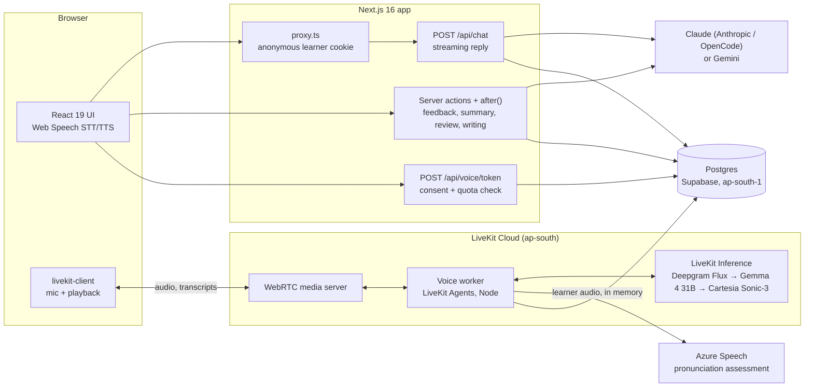

# Fluency

A web app for practicing spoken English, built first for Bangla speakers. You pick a scenario, speak or type, and a conversation partner replies out loud. After each session you get feedback, flashcards for review, and a pronunciation score when you use live voice.

What is built so far and what comes next: [doc/status.md](doc/status.md) and [doc/roadmap.md](doc/roadmap.md).

## Architecture

Fluency has two runtimes that share one Postgres database:

- **The Next.js app** serves the pages, streams typed and browser-speech conversation turns, and runs the language-model work after each session: feedback, the tutor note, placement, review sentences and the writing coach.
- **The voice worker** (`worker/main.ts`) is a long-running LiveKit Agents process on LiveKit Cloud. It joins a learner's WebRTC room and runs the real-time speech loop.



### How a turn moves through the system

**Typed or browser-speech turn.** Chrome's Web Speech API turns speech into text in the browser, or the learner types. `POST /api/chat` validates the request (`lib/chat-request.ts`) and loads the session's saved turns from Postgres. It then builds a system prompt from:

- the scenario;
- the learner's CEFR level and native language;
- a private tutor note of at most 700 characters, rebuilt after each session;
- the learner's due flashcards and recent mistakes.

The reply streams back as plain text, token by token. The browser speaks it sentence by sentence with `speechSynthesis`, so audio starts before the reply is finished. `lib/reply-stream.ts` fails the request if the provider sends no first token within 20 s, or goes silent for 15 s once streaming.

**Live voice turn.** `POST /api/voice/token` checks consent and the learner's remaining 300 s for the day, counted in Asia/Dhaka time. It then signs a LiveKit token that dispatches the worker named in `VOICE_AGENT_NAME` (`fluency-tutor` in production) with the learner and scenario. In the room, the worker runs three stages through LiveKit Inference:

1. **Deepgram Flux** transcribes the speech. It sends an early end-of-turn signal, and the worker uses that signal to start drafting a reply before the learner has certainly finished (preemptive generation).
2. **Gemma 4 31B** writes the reply. It was chosen for the fastest time to first token, about 426 ms at p50.
3. **Cartesia Sonic-3** speaks the reply. Its speaking speed follows the learner's CEFR level.

Each exchange is saved to the same tables as text chat, on a serial promise chain so turns stay in order. A meter writes connected time to `voice_usage` every 15 s. When the time runs out, the worker lets the current reply finish, says goodbye and closes the room.

**Pronunciation, off the critical path.** The worker splits the learner's audio into two copies (`tee()`): one goes to Flux, the other into a 60 s in-memory buffer at 16 kHz. Once Flux's final transcript arrives, the worker cuts that turn's audio out of the buffer and sends it to Azure for scripted assessment, with the transcript as the reference text. Nothing on the reply path waits for this. The scores and phoneme mismatches are saved; the audio is dropped and never stored.

**After the session.** "Finish and get feedback" schedules the feedback job with Next.js `after()`, so the response isn't held up. `session_feedback` doubles as the job record: a sweeper retries a job still pending after 5 minutes (3 attempts in all), and ends a conversation left idle for 30 minutes, such as a closed tab, so it still gets its feedback and tutor note (`lib/sweep.ts`). The feedback model makes precision-first corrections, which means a sentence is only flagged when it is really wrong. It also suggests more natural phrasing and picks up to five vocabulary items, with explanations in the learner's native language. The results become recurring error patterns, and the learner can save them as flashcards.

**Review.** Cards are scheduled with FSRS (`ts-fsrs`). For each review, the conversation model writes a fresh fill-in-the-blank sentence. The rating comes from the answer: wrong gives Again, close gives Hard, and a correct answer gives Easy, Good or Hard depending on how fast it was. The speed thresholds adapt to the learner after 30 reviews.

### Technology

| Layer             | Technology                                                                                                                    | Why                                                                                                                                                                                                      |
| ----------------- | ----------------------------------------------------------------------------------------------------------------------------- | -------------------------------------------------------------------------------------------------------------------------------------------------------------------------------------------------------- |
| Web app           | Next.js 16 (App Router, Cache Components / partial prerendering, `proxy.ts`, server actions, `after()`), React 19, TypeScript | Each page serves a static shell and streams in the learner's data. Server actions and `after()` run the model work after a response. The sweeper retries what didn't finish, with Postgres as the queue. |
| UI                | Tailwind CSS 4, shadcn/ui on Base UI, lucide icons                                                                            | Accessible primitives and design tokens (`DESIGN.md`). The interface is in English and Bangla (`lib/messages.ts`).                                                                                       |
| Conversation AI   | Claude Sonnet 5.5 (Anthropic API or OpenCode), Gemini 3.8 Flash                                                               | Picked by env var behind one `AsyncIterable<string>` interface (`lib/provider.ts`, `lib/ai.ts`).                                                                                                         |
| Feedback AI       | Claude Opus 5.5                                                                                                               | Corrections need precision more than speed. The eval measures over-correction directly.                                                                                                                  |
| Browser speech    | Web Speech API (recognition and synthesis)                                                                                    | Free and instant, and the fallback whenever live voice is off or unavailable.                                                                                                                            |
| Real-time voice   | LiveKit Cloud (WebRTC), LiveKit Agents for Node                                                                               | One vendor for transport, worker hosting and inference. The worker sits next to the model gateways, not in Dhaka.                                                                                        |
| Speech models     | Deepgram Flux (STT), Gemma 4 31B (LLM), Cartesia Sonic-3 (TTS), all through LiveKit Inference                                 | Each was chosen by measurement: Flux's early end-of-turn signal, Gemma's time to first token, and Cartesia's ability to speak the Bangla help clearly ([doc/voice-path.md](doc/voice-path.md)).          |
| Pronunciation     | Azure Speech pronunciation assessment (scripted mode)                                                                         | Gives phoneme-level scores. Scripted mode on the Flux transcript avoids the misrecognitions that unscripted mode then marked as mispronounced.                                                           |
| Database          | PostgreSQL (Supabase in production, Docker locally), Drizzle ORM, postgres.js                                                 | Typed schema and SQL migrations in `drizzle/`. The Session pooler keeps the database reachable over IPv4 from LiveKit Cloud.                                                                             |
| Spaced repetition | ts-fsrs (FSRS-6)                                                                                                              | Modern scheduling, with per-learner parameters stored for later tuning.                                                                                                                                  |
| Validation        | Typed parsers (`parseChatRequest`, `parseFeedback`, `parseJobMetadata`)                                                       | Request bodies, model JSON output and job metadata are checked before use, and each parser has unit tests.                                                                                               |
| Testing           | Vitest (a `unit` project and a `db` project against a real `fluency_test` database), `pnpm eval`                              | Database code is tested against Postgres, not mocks. The eval scores the corrector on 200 Bangla-speaker sentences.                                                                                      |
| Deployment        | Docker image of the worker on LiveKit Cloud `ap-south`, Supabase `ap-south-1` (both in Mumbai)                                | The worker and database are in the same region, close to Bangladesh.                                                                                                                                     |

### Data model

The schema is in `lib/db/schema.ts`, with nine tables:

- `learner_profiles`: language pair, CEFR levels in four skills, FSRS parameters, the tutor note, and voice consent.
- `sessions` and `session_turns`: transcripts, including how each turn was input and its latency fields.
- `session_feedback`: the corrections and vocabulary for a session's recap.
- `learner_error_patterns`: recurring grammar and pronunciation errors.
- `fsrs_cards` and `fsrs_review_logs`: flashcards and every review.
- `voice_usage`: the daily live voice seconds.
- `pronunciation_scores`: one row per scored live voice turn.

### Engineering constraints

- **Latency is measured, not assumed.** Every assistant turn records server time to first token and client time to first audio. Live voice is held to a gate measured in the browser: p50 under 1.6 s and p90 under 2.2 s from the end of the learner's speech to the first audible reply. The browser detects both moments from audio levels, and `pnpm voice:latency` and `pnpm voice:bench` report against the gate. The gate started at 750 / 950 ms. Per-turn timelines showed this pipeline can't go below about 800 ms from Dhaka even with the model and voice fully hidden, so it was reset on 2026-10-27 ([doc/voice-path.md](doc/voice-path.md), Decision 2).
- **No raw audio is kept.** The worker runs with recording off. The audio used for pronunciation lives in memory only until its turn is scored. Only transcripts and scores are saved.
- **A daily cost cap.** Live voice is limited to 5 minutes a day per learner, reset at midnight Bangladesh time. The token route checks it, and the worker meters it and stops the session at the limit.
- **Corrections must not over-correct.** `pnpm eval` runs the real feedback prompt against a golden set and reports how often it flags error-free sentences. The latest run flagged 0 of 100 error-free sentences, with an edit F0.5 of 0.953.
- **Designed for Bangla speakers first.**
  - The interface and explanations can be in Bangla.
  - A catalog of Bangla-speaker pronunciation patterns (`lib/pronunciation-patterns.ts`) covers sounds such as /v/ → [b] and /w/ → [v].
  - The text-to-speech voice was chosen because it reads the mixed English and Bangla help clearly.
- **Graceful fallbacks.** If live voice is unavailable, refused or out of time, the learner can still use browser speech and typing. If Azure isn't configured, the worker skips scoring. If a provider fails, the learner gets a clear 502, 503 or 504 message instead of a broken stream.
- **Anonymous until Phase 5.** `proxy.ts` gives each browser an anonymous learner ID in a cookie, and Settings has "Delete my data". Login comes in Phase 5.

### Repository layout

```
app/          Next.js routes: practice, placement, history, review, write, settings, api/chat, api/voice/token
components/   React components (Conversation, Recap, ScenarioPicker, UI primitives)
hooks/        Client state machines: useConversation (Web Speech loop), useLiveVoice (LiveKit)
lib/          Server and shared logic: prompts, providers, sessions, feedback, FSRS, quota, pronunciation
lib/db/       Drizzle schema
drizzle/      SQL migrations
worker/       LiveKit Agents voice worker and its database helpers
scripts/      eval harness and voice benchmarks (TTFT, TTS A/B, Azure, call, latency)
doc/          Feature docs, decision records, roadmap and status
```

Each feature has its own page in [doc/](doc/README.md).

## Requirements

- Node.js 26 (the voice worker runs TypeScript directly with Node's type stripping)
- pnpm 11 (`packageManager` in `package.json` pins the version)
- Docker, for the local database
- Chrome, for browser speech recognition. Typing works in every browser.
- For live voice: a LiveKit Cloud project and an Azure Speech resource. To deploy the worker: the `lk` CLI (`brew install livekit-cli`).

## Setup

```bash
pnpm install
cp .env.example .env
```

Use `.env`, not `.env.local`: the `voice:*` scripts and the voice worker read only `.env`. Next.js and Drizzle read both.

### Environment variables

| Variable                                                 | Needed for                         | Notes                                                                                                                                                                                           |
| -------------------------------------------------------- | ---------------------------------- | ----------------------------------------------------------------------------------------------------------------------------------------------------------------------------------------------- |
| `CLAUDE_API_KEY`, `GOOGLE_API_KEY` or `OPENCODE_API_KEY` | Chat, feedback, placement, writing | Set at least one. With only one set, Fluency uses that provider. With more than one, pick with `AI_PROVIDER=claude`, `google` or `opencode`. `ANTHROPIC_API_KEY` is accepted as the Claude key. |
| `DATABASE_URL`                                           | Everything                         | The value in `.env.example` matches the local Docker database.                                                                                                                                  |
| `LIVEKIT_URL`, `LIVEKIT_API_KEY`, `LIVEKIT_API_SECRET`   | Live voice                         | From your LiveKit Cloud project. The speech and language models run through LiveKit Inference with these keys, so there is no Deepgram key.                                                     |
| `VOICE_AGENT_NAME`                                       | Live voice                         | The worker's name. Keep `fluency-tutor-dev` locally; only production uses `fluency-tutor`. Live voice is off without it.                                                                        |
| `CRON_SECRET`                                            | The daily sweep                    | Production only. `/api/cron/sweep` is off without it. Vercel Cron sends it as a bearer token.                                                                                                   |
| `AZURE_SPEECH_KEY`, `AZURE_SPEECH_REGION`                | Pronunciation scoring              | Use a region near Bangladesh, such as `southeastasia`. Without them, live voice works but turns aren't scored.                                                                                  |
| `CARTESIA_API_KEY`, `GRADIUM_API_KEY`                    | `pnpm voice:tts-ab` only           | The text-to-speech A/B test. The app doesn't need them.                                                                                                                                         |

Keys are read only on the server.

### Local database

Start Postgres in Docker and apply the migrations:

```bash
pnpm db:up
pnpm db:migrate
```

Other database scripts:

- `pnpm db:generate`: create a migration after changing `lib/db/schema.ts`
- `pnpm db:studio`: browse the data
- `pnpm db:down`: stop the database, keeping its data

## Run the app

```bash
pnpm dev
```

Open [http://localhost:3000](http://localhost:3000). A new learner goes through onboarding and a short placement chat, then reaches Practice, History, Review (flashcards), Write and Settings.

## Live voice

Live voice is real-time spoken conversation through LiveKit. The browser gets a token from `POST /api/voice/token`, and a separate worker process (`worker/main.ts`) joins the room. The worker runs speech-to-text, the language model and text-to-speech, saves the turns, meters each learner's 5 minutes a day (Bangladesh time) and scores pronunciation. Details are in [doc/voice-worker.md](doc/voice-worker.md).

To use it locally:

1. Set the `LIVEKIT_*`, `VOICE_AGENT_NAME` and `AZURE_*` variables in `.env`.
2. Start the worker in a second terminal. It registers with LiveKit Cloud from your machine:
   ```bash
   pnpm voice:worker dev
   ```
3. In the app, agree to live voice in Settings, then press **Start live voice** on the Practice page.

The local worker and the app both use `VOICE_AGENT_NAME` from `.env` (`fluency-tutor-dev`). The deployed worker and the production app use `fluency-tutor`, so a worker on your machine never takes a production session. To test against the deployed worker, run the app with `.env.supabase`, which sets `fluency-tutor` (see Deployment).

### Voice scripts

| Script                                                                              | What it does                                                                                                                                                                                                                                                                                                |
| ----------------------------------------------------------------------------------- | ----------------------------------------------------------------------------------------------------------------------------------------------------------------------------------------------------------------------------------------------------------------------------------------------------------- |
| `pnpm voice:call --learner <uuid> [--scenario cafe] [--session <uuid>] a.wav b.wav` | Joins a room as a scripted learner and plays each WAV file as a turn. The learner must exist in the database the worker uses and must have agreed to live voice.                                                                                                                                            |
| `pnpm voice:latency [--since YYYY-MM-DD] [--learner <uuid>]`                        | Reports p50 and p90 from the end of speech to the first reply audio, measured in the browser, against the gate (p50 < 1.6 s, p90 < 2.2 s). It needs at least 20 turns for a verdict.                                                                                                                        |
| `pnpm voice:bench [--url <app>] [--learners 1-5] [--wav <file>]`                    | Headless Chrome plays a WAV as the microphone in live voice sessions, then reports the run against the gate with the network round trip and jitter buffer. The worker logs a matching per-turn `timeline:` line. See [doc/voice-worker.md](doc/voice-worker.md#the-bench-and-the-per-turn-timeline-flu-72). |
| `pnpm voice:ttft`                                                                   | Benchmarks time to first token for the language model candidates.                                                                                                                                                                                                                                           |
| `pnpm voice:tts-ab`                                                                 | The text-to-speech A/B test.                                                                                                                                                                                                                                                                                |
| `pnpm voice:azure`                                                                  | Scores a recording with Azure pronunciation assessment.                                                                                                                                                                                                                                                     |

## Tests and evaluation

- `pnpm test`: unit tests
- `pnpm test:db`: database tests, run against a separate `fluency_test` database. It's created and migrated automatically, but needs `pnpm db:up` first.
- `pnpm eval`: scores the corrector against `scripts/eval/golden/bn-en.json` ([doc/evaluation.md](doc/evaluation.md))
- `pnpm lint` and `pnpm format`

### CI

GitHub Actions runs three workflows from `.github/workflows/`:

| Workflow             | Runs                                                                                    | Does                                                                                                                                         |
| -------------------- | --------------------------------------------------------------------------------------- | -------------------------------------------------------------------------------------------------------------------------------------------- |
| `CI`                 | Every push                                                                              | `tsc --noEmit`, `pnpm lint`, `pnpm test`, `pnpm test:db` against a Postgres 18 service, and `pnpm build`. It needs no secrets and no `.env`. |
| `Eval`               | Pushes that change `lib/feedback.ts`, `lib/anthropic.ts` or `scripts/eval/`, or by hand | `pnpm eval` on the real feedback model. It fails on over-correction of 5% or more, or a rise over the baseline. Each run costs money.        |
| `Migrate production` | By hand only                                                                            | `pnpm db:migrate` against production.                                                                                                        |

Secrets, set in the repository's Settings → Secrets and variables → Actions:

- `OPENCODE_API_KEY` (repository secret) for `Eval`. Without it, `Eval` is skipped with a notice.
- `DATABASE_URL` (secret of the `production` environment) for `Migrate production`: the Session pooler URL with the `postgres` login, since migrations change the schema.

GitHub only offers the "Run workflow" button for workflows that are on the default branch (`main`).

## Deployment

### Database: Supabase

The managed database is Supabase Postgres in Mumbai (`ap-south-1`). Connect through the **Session pooler** (`aws-0-ap-south-1.pooler.supabase.com:5432`, user `postgres.<project-ref>`). The direct host `db.<ref>.supabase.co` has only an IPv6 address, so LiveKit Cloud can't reach it. Session mode supports the prepared statements the app uses.

The Supabase Data API is turned off. The tables have no row-level security, so leave it off.

**Logins.** Each runtime gets only the access it needs (FLU-100). Migration `0007_app_roles` creates two roles without login rights and grants them:

| Role             | Used by                     | Can                                                                                                                                                    |
| ---------------- | --------------------------- | ------------------------------------------------------------------------------------------------------------------------------------------------------ |
| `postgres`       | Migrations only             | Everything, including schema changes                                                                                                                   |
| `fluency_app`    | The web app and the scripts | Read and write every table, including tables later migrations add. No schema changes.                                                                  |
| `fluency_worker` | The voice worker            | Read learners, cards and error patterns; add sessions, turns and pronunciation scores; update voice usage. No deletes, no feedback, no schema changes. |

A table the worker needs later is granted in that table's own migration. `lib/db-roles.db.test.ts` runs the worker's real queries as `fluency_worker`, so a missing grant fails the tests.

To turn the roles into logins on Supabase, run this once in the SQL editor with two new passwords (`openssl rand -hex 24` gives ones that need no URL encoding):

```sql
ALTER ROLE fluency_app WITH LOGIN PASSWORD '<app password>';
ALTER ROLE fluency_worker WITH LOGIN PASSWORD '<worker password>';
```

Through the pooler, a role's user name is `<role>.<project-ref>`, for example `fluency_app.<project-ref>`.

Keep the production settings in `.env.supabase` at the repo root. It's gitignored by the `.env*` rule, so `.env` can stay pointed at the local database and the local worker. Percent-encode `@ : / ? # %` in a password.

```
# The app's login. Migrations use MIGRATION_DATABASE_URL instead (drizzle.config.ts).
DATABASE_URL=postgresql://fluency_app.<project-ref>:<password>@aws-0-ap-south-1.pooler.supabase.com:5432/postgres
MIGRATION_DATABASE_URL=postgresql://postgres.<project-ref>:<password>@aws-0-ap-south-1.pooler.supabase.com:5432/postgres
VOICE_AGENT_NAME=fluency-tutor
```

**Serverless.** On Vercel, every function instance holds its own connections, and the Session pooler's limit is shared by all of them. There, use the **Transaction pooler** (port `6543`) and set `DATABASE_POOL_MAX=1`. `lib/db.ts` turns prepared statements off on port 6543, because that pooler hands each transaction to whichever server connection is free. The voice worker and your machine stay on the Session pooler.

Variables from `--env-file` win over `.env`, so a command run with `.env.supabase` uses production's database and worker.

**Migrations only add things.** The web app and the voice worker deploy separately, so for a while the old code runs against the new schema. Add tables and nullable or defaulted columns first, and rename or drop in a later release, once no deployed code uses the old shape. Migrate before deploying the code that needs it, with the `Migrate production` workflow (see CI) or from your machine.

To run migrations against Supabase from your machine, pass the URLs in through the environment. `drizzle.config.ts` uses `MIGRATION_DATABASE_URL`, falling back to `DATABASE_URL`, and doesn't override variables that are already set.

```bash
node --env-file=.env.supabase -e "require('child_process').execFileSync('pnpm',['db:migrate'],{stdio:'inherit'})"
```

### Voice worker: LiveKit Cloud

The worker is deployed as a LiveKit Cloud agent in region `ap-south` (Mumbai), the same AWS region as the database. `livekit.toml` holds the project and the agent ID, and `Dockerfile` builds the image. There is no build step, and `.dockerignore` keeps `.env*` files out of the upload.

`lk` reads `LIVEKIT_URL`, `LIVEKIT_API_KEY` and `LIVEKIT_API_SECRET` from the environment, so you can skip `lk cloud auth` by exporting them from `.env`:

```bash
set -a; source .env; set +a

lk agent deploy      # upload, build on LiveKit Cloud, and roll out a new version
lk agent status      # should show Running
lk agent logs        # add --log-type=build for the build logs
lk agent secrets     # list secret names
```

The agent needs four secrets: `DATABASE_URL` (the Session pooler URL with the `fluency_worker` login), `VOICE_AGENT_NAME=fluency-tutor`, `AZURE_SPEECH_KEY` and `AZURE_SPEECH_REGION`. Without `VOICE_AGENT_NAME` the worker exits at start, so set it before deploying a version that reads it. LiveKit Cloud provides the `LIVEKIT_*` variables itself. To change the secrets, write them to a file outside the repo, one `KEY=value` per line. Then apply the file and delete it:

```bash
lk agent update-secrets --secrets-file /path/to/agent-secrets.env   # restarts the agent
```

To set up the agent from scratch, which creates a new `livekit.toml`:

```bash
lk agent create --region ap-south --secrets-file /path/to/agent-secrets.env .
```

To check a deploy end to end, run `pnpm voice:call` with `.env.supabase` (so it dispatches to `fluency-tutor`) and a learner that exists in Supabase and has voice consent. The turns, voice usage and pronunciation scores should appear in Supabase.

### Web app

The Next.js app isn't deployed yet. When it is, set the same variables as `.env`, with `DATABASE_URL` pointing at the Supabase pooler URL. There is no login until Phase 5, so anyone with the URL can use the AI provider key.

## Costs

[doc/cost-calculator.html](doc/cost-calculator.html) estimates the monthly cost of running Fluency in production. You can change the number of learners, their usage, the plans, the models, and every price and assumption. GitHub shows only the file's source, so open it in a browser:

```bash
open doc/cost-calculator.html
```

With its defaults, a typical learner costs about **$5 a month**. The plans add **$95 a month**: Vercel Pro ($20), Supabase Pro ($25) and LiveKit Ship ($50). A typical learner practises on 15 days a month. On each of those days they do a 10-turn typed session, 3 minutes of live voice and 10 flashcards, and they do 2 writing checks a month.

| Learners | LiveKit plan | Total a month | Per learner |
| -------- | ------------ | ------------- | ----------- |
| 10       | Ship         | $136          | $13.63      |
| 100      | Ship         | $552          | $5.52       |
| 500      | Ship         | $2,571        | $5.14       |
| 1,000    | Scale        | $4,755        | $4.76       |
| 5,000    | Scale        | $23,546       | $4.71       |

- **Live voice costs the most.** It's about $0.054 a minute, and half of that is Cartesia's text-to-speech. The 5-minute daily quota holds voice to about $10 per learner a month.
- **Claude jobs cost the most after voice.** The feedback, tutor note and pronunciation tips after each session run on Claude Opus 5.5 (the `feedback` model in `lib/anthropic.ts`).
- **Typed chat has no quota,** so the totals hold only while learners stay near the usage above.
- **LiveKit Scale ($500) is needed** once about 20 voice sessions run at once. The calculator puts that at roughly 1,000 typical learners in one time zone.

Prices were checked on 2026-10-28. Token and character counts are estimated from the prompts, not measured. When a price changes, update its default in `PRICE_FIELDS` in the calculator.
